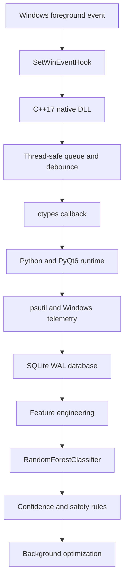
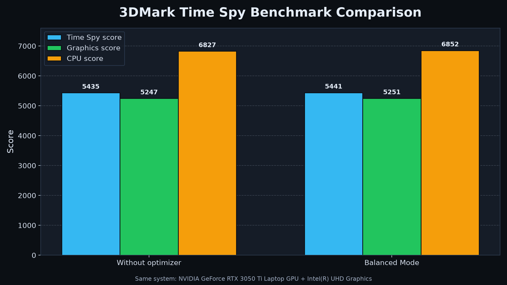

<div align="center">

# ⚡ Adaptive RAM Optimizer

### Event-driven Windows optimization for smoother frame pacing

<p>
  
  
  
  
  
</p>

<p>
  <a href="#english">🇬🇧 English</a> ·
  <a href="#turkce">🇹🇷 Türkçe</a>
</p>

</div>

<a id="english"></a>

## 🇬🇧 English

> **Important: This is an experimental test project. It has not had a final
> production release yet.** The application may improve frame pacing or
> performance in some games, but results depend on the hardware, game,
> drivers, Windows configuration, and background workload.

### ℹ️ Online-game compatibility note

The optimizer is designed as a normal Windows performance utility; it does not
inject code into games, modify game files, or terminate processes. However,
online games and their anti-cheat systems can have different rules for
process-priority and memory-management tools. Some anti-cheat implementations
may therefore react to this type of utility even when it is not intended to
cheat.

This is a compatibility consideration, not a claim that the application is
inherently dangerous. The safest place to evaluate it is a single-player game
or a game without anti-cheat. For an online game, check its policy and test
the specific game/anti-cheat combination before regular use; benchmark results
do not establish compatibility.

### What the project does

Adaptive RAM Optimizer is a Windows desktop application that observes
foreground-window changes, collects local process and system telemetry, and
selects conservative background optimization candidates. It does not terminate
processes and never optimizes the foreground process.

The application combines a native C++ event layer with a Python desktop
application:

1. Windows reports a foreground-window change through `SetWinEventHook`.
2. The C++17 DLL transfers the event through a thread-safe worker and callback.
3. Python collects CPU, RAM, working-set, commit-size, thread, handle, and
   focus-duration data with `psutil` and Windows APIs.
4. Telemetry is stored locally in SQLite using WAL mode and indexed tables.
5. A `RandomForestClassifier` learns from observed behavior and scores possible
   background candidates.
6. Safety rules, confidence thresholds, cooldowns, protected-process checks,
   foreground checks, and GPU-load checks limit optimization actions.

### How does it optimize RAM?

The application does **not** delete files, erase game data, clear textures, or
randomly remove information from RAM. It asks Windows to manage selected
background processes more efficiently:

1. A process that has been in the background long enough and passes the model
   and safety checks is selected.
2. Its Windows memory priority is lowered, so Windows can prefer active
   applications when physical RAM is under pressure.
3. `EmptyWorkingSet` is requested for that process. This releases pages from
   the process's physical working set, making those physical RAM pages
   available to Windows for other work.
4. The process itself, its files, and its committed virtual memory are not
   deleted. If the process needs those pages again, Windows can load or
   recreate them as normal, so a later access may involve disk I/O.

The tool measures the process's working-set change rather than promising a
fixed amount of free RAM. Windows may decline an operation because of
permissions or process state. The operation is also protected by minimum-size
checks and per-process cooldowns, so it is not performed continuously.

Priority management is a separate, lighter operation: eligible background
processes may receive below-normal CPU/I/O and memory priority, while the
foreground process is restored to normal priority. This helps the active game
or application compete for resources; it does not change the game's files or
delete its RAM contents.

### Why these technologies and methods?

#### C++17 and the Win32 API

The native layer uses C++17, `User32`, `SetWinEventHook`,
`EVENT_SYSTEM_FOREGROUND`, and `WINEVENT_OUTOFCONTEXT`. This gives the
application an operating-system event source instead of requiring a tight
Python loop that repeatedly scans windows.

The choice is intentional:

- native event hooks have lower monitoring overhead than frequent polling;
- `std::thread`, `std::mutex`, `std::condition_variable`, and `std::queue`
  provide a predictable producer-consumer boundary;
- the exported C-compatible DLL API keeps the Python/native boundary small;
- the Windows message pump lets the hook remain responsive on its own thread.

Foreground events are debounced before being delivered to Python. This avoids
performing repeated work while a user rapidly switches windows.

#### Python and PyQt6

Python is used for the application layer because it provides mature libraries
for process telemetry, data processing, model training, and rapid iteration.
PyQt6 provides the desktop interface, while `QThread` and Qt signals keep
training and other longer operations away from the UI thread.

`ctypes`, `WinDLL`, and `WINFUNCTYPE` are used instead of an additional
extension-building layer. This keeps the native interface explicit and makes
the C++ DLL usable from a standard Python installation.

#### psutil and Windows process APIs

`psutil` supplies cross-process CPU, memory, thread, and handle observations.
Windows APIs are used where Windows-specific control is required, including
process priority and working-set operations. Combining both lets the project
observe more than RAM usage alone: background time, focus ratio, CPU pressure,
and process behavior can all affect a decision.

#### SQLite with WAL mode

SQLite is used because telemetry is local, portable, and does not require a
server. WAL (write-ahead logging) allows the runtime to write telemetry while
the interface or training worker reads it, reducing unnecessary read/write
blocking. Relational tables, indexes, and foreign-key relationships keep
snapshots and process observations queryable without creating a separate
database service.

No telemetry is sent to a remote service. User databases, WAL/SHM files, and
trained model files remain local and should not be committed to Git.

#### pandas, NumPy, scikit-learn, and Random Forest

The data pipeline uses pandas for tabular preparation and joins, NumPy for
numeric feature calculations, and scikit-learn for classification. Features
include time-of-day, weekend status, working-set and commit memory, CPU,
thread and handle counts, foreground/background time, focus ratio, and total
RAM pressure.

`RandomForestClassifier` was chosen because it:

- handles mixed, non-linear process behavior without requiring feature scaling;
- is relatively interpretable through feature importance;
- provides class probabilities for confidence-based safety gates;
- works well for an experimental tabular dataset without a deep-learning
  runtime or GPU requirement.

The model is not allowed to make an unrestricted decision. Unknown or
low-confidence processes remain protected, and historical safety outcomes are
used to become stricter or more permissive only after enough observations.

#### Conservative optimization policy

The project separates priority management from working-set trimming. A
background process must satisfy rules such as minimum background duration,
model confidence, CPU limits, protected-process exclusions, and per-process
cooldowns. Priority changes are capped per optimization pass. The foreground
application is restored to normal priority immediately when focus changes.
Process creation times are tracked so a reused PID cannot inherit an old
decision.

GPU-heavy workloads are handled conservatively. GPU vendor detection occurs
once; NVIDIA load is sampled through `nvidia-smi` no more than once every five
seconds. At high GPU load, managed priorities are restored and optimization is
paused for that pass. AMD and Intel systems do not repeatedly launch a missing
NVIDIA utility.

These safeguards are intended to keep the utility predictable and low
overhead. They improve compatibility, but no Windows utility can guarantee
identical results on every system or acceptance by every anti-cheat.

## 🧰 Technology stack

| Area | Technologies | Reason for use |
| --- | --- | --- |
| Native monitoring | C++17, Win32 API, `User32`, `SetWinEventHook` | Low-overhead Windows event integration |
| Native concurrency | `std::thread`, mutex, condition variable, queue | Safe event transfer and debouncing |
| Python runtime | Python 3.10+, `ctypes`, `psutil` | Fast iteration and Windows/process telemetry |
| Desktop UI | PyQt6, `QThread`, Qt signals | Responsive native-style Windows interface |
| Storage | SQLite, WAL, indexes, foreign keys | Local, portable telemetry with concurrent access |
| Data preparation | pandas, NumPy | Feature engineering and numeric calculations |
| Machine learning | scikit-learn, Random Forest, joblib | Confidence-based candidate classification |
| Build | CMake 3.20+, MSVC/Visual Studio 2022 | Reproducible x64 DLL builds |
| Packaging | PyInstaller, GitHub Actions | One-file Windows executable and CI artifacts |

## 🏗️ Architecture



## ✨ Main features

- Event-driven foreground monitoring with a lightweight UI heartbeat
- C++17 DLL to Python callback bridge
- Thread-safe event queue and debounce logic
- CPU, RAM, working-set, commit-size, thread, handle, and focus metrics
- Local SQLite telemetry with WAL mode and indexes
- Adaptive Random Forest candidate scoring
- Protected-process, foreground, confidence, cooldown, and GPU safeguards
- PyQt6 desktop interface with background workers
- Optional one-file Windows `.exe` packaging with PyInstaller

## 📁 Project structure

```text
AdaptiveRamOptimizer/
├── app_gui.py                       # PyQt6 interface and Python runtime
├── optimizer_core.cpp               # Win32 event hook and native worker
├── optimizer_core.h                 # DLL API and TelemetryData structure
├── CMakeLists.txt                   # Native DLL build definition
├── requirements.txt                 # Python dependencies
├── AdaptiveRamOptimizer.spec        # PyInstaller specification
├── build_optimizer_core.bat         # C++ DLL build script
├── build_exe.bat                    # Windows EXE build script
├── setup.bat                         # Small EXE installer/shortcut script
├── .github/workflows/
│   └── build-windows.yml            # GitHub Actions Windows build
├── docs/                            # Benchmark images
└── README.md                        # Project documentation
```

## 🚀 Installation and development

### Requirements

- Windows 10/11 x64
- Python 3.10 or newer
- Visual Studio 2022 Build Tools with the Desktop C++ workload
- CMake 3.20 or newer

### Install Python dependencies

Install Python from [python.org](https://www.python.org/downloads/windows/) first.
During installation, enable **Add python.exe to PATH**. Open a new
PowerShell window in the project folder and verify that the Python launcher is
available:

```powershell
py -3 --version
```

The project dependencies do not need to be installed one by one.
`build_exe.bat` installs every package listed in `requirements.txt`
automatically. To install them manually, run:

```powershell
py -3 -m pip install -r requirements.txt
```

If `py` is not recognized, use `python` instead:

```powershell
python -m pip install -r requirements.txt
```

### Build the native DLL

Building the DLL requires **Visual Studio 2022 Build Tools** with the
**Desktop development with C++** workload and **CMake 3.20+**. This step is
not needed when a matching `optimizer_core.dll` is already next to
`build_exe.bat`.

```powershell
call build_optimizer_core.bat
```

This builds the x64 Release DLL with CMake and places `optimizer_core.dll`
next to the application. Native build output and packaged binaries should not
be committed to Git.

### Build the executable

After the Python dependencies are installed and `optimizer_core.dll` is
available in the project folder, run:

```powershell
call build_exe.bat
```

The output is:

```text
dist\AdaptiveRamOptimizer.exe
```

### Install from a downloaded archive

For a small, dependency-free installation step, keep
`AdaptiveRamOptimizer.exe` next to `setup.bat` in the downloaded archive, then
double-click `setup.bat`. It copies the application to:

```text
%LOCALAPPDATA%\AdaptiveRamOptimizer
```

The script creates Start Menu and desktop shortcuts, then launches the
application. The setup file itself is only a small Windows batch launcher; the
large application payload remains the already-built EXE, so it does not create
another copy of the full application inside the installer.

The recommended release archive layout is:

```text
AdaptiveRamOptimizer/
├── AdaptiveRamOptimizer.exe
└── setup.bat
```

The archive can be distributed as `.rar`. Windows may require an archive
utility such as 7-Zip or WinRAR to extract it before running `setup.bat`.

### Run from source

```powershell
py -3 app_gui.py
```

User data is stored locally under:

```text
%LOCALAPPDATA%\AdaptiveRamOptimizer
```

## 📊 Benchmark results

The following sample was recorded with Counter-Strike 2. It demonstrates that
performance and frame pacing can change, but it is not a universal result and
does not prove anti-cheat compatibility.

<div align="center">
  
</div>

<div align="center">
  
</div>

| Profile | Average FPS | 1% Low FPS | Outlier frames |
| --- | ---: | ---: | ---: |
| Stock (No App) | 209.0 | 106.4 | 4,064 |
| Soft Mode | 194.2 | 101.0 | 3,625 |
| Aggressive | 205.8 | 102.3 | 4,058 |
| **Balanced (Our App)** | **229.0** | **107.1** | **0** |

In this sample, Balanced Mode was approximately 9.57% faster than the Stock
profile. The result depends on the test system and run, and should not be
presented as a guaranteed FPS increase.

### 3DMark Time Spy results

The following Time Spy runs were recorded on the same system with an NVIDIA
GeForce RTX 3050 Ti Laptop GPU and Intel(R) UHD Graphics. The two runs are
close, so this comparison should be treated as a single sample rather than a
statistically significant performance claim.

<div align="center">
  
</div>

| Profile | Time Spy score | Graphics score | CPU score |
| --- | ---: | ---: | ---: |
| Without optimizer | 5,435 | 5,247 | 6,827 |
| **Balanced Mode** | **5,441** | **5,251** | **6,852** |

Balanced Mode achieved slightly higher performance in this pair of Time Spy
runs: 6 points higher overall (approximately 0.11%), with small gains in both
the Graphics and CPU scores. This is a minimal improvement and the result may
vary between runs, so more benchmark data is needed before drawing a reliable
general conclusion.

<div align="center">
  
  
</div>

<p align="center"><em>Left: Balanced Mode (5,441). Right: Without optimizer (5,435).</em></p>

## 🛡️ Safety and known limitations

- This is a test project and is not yet a final production release.
- It does not inject code, modify game files, terminate processes, or delete
  game data.
- Some online anti-cheat systems may treat process-management utilities
  differently; single-player or anti-cheat-free games are the best test case.
- The project does not terminate processes and does not optimize the
  foreground process.
- Windows may deny access to protected or administrator-owned processes.
- The first run may not contain enough data for model training.
- Results vary because the model learns from local usage data.
- The `Test (10% RAM)` mode is experimental and aggressive.
- `Balanced` is recommended for normal testing.
- A compatible Microsoft Visual C++ runtime may be required.

## ⚙️ GitHub Actions

`.github/workflows/build-windows.yml` builds a Windows artifact when manually
dispatched or when a tag matching `v*` is pushed. It installs dependencies,
builds the executable with PyInstaller, and uploads an artifact named
`AdaptiveRamOptimizer-windows`.

## 📄 License

MIT License. See [`LICENSE`](LICENSE) for details.

---

<a id="turkce"></a>

## 🇹🇷 Türkçe

> **Önemli: Bu proje deneysel bir test projesidir. Henüz tam ve kararlı bir
> son kullanıcı sürümü olarak yayınlanmamıştır.** Uygulama bazı oyunlarda
> kare sürelerini ve performansı iyileştirebilir; ancak sonuçlar donanıma,
> oyuna, sürücülere, Windows ayarlarına ve arka plan yüküne göre değişir.

### ⚠️ Anti-cheat ve çevrim içi oyun uyarısı

Optimizer, hile amacı taşıyan bir araç değildir; oyuna kod enjekte etmez, oyun
dosyalarını değiştirmez ve işlem sonlandırmaz. Yine de çevrim içi oyunların
anti-cheat sistemleri işlem önceliği ve bellek yönetimi araçlarına farklı
tepkiler verebilir. Bazı sistemler, uygulama hile yapmasa bile bu tür bir
yardımcı programı şüpheli görebilir.

Bu bir "uygulama tehlikelidir" iddiası değil, oyunlarla uyumluluk notudur.
En rahat değerlendirme alanı tek oyunculu veya anti-cheat bulunmayan oyunlardır.
Çevrim içi bir oyunda düzenli kullanımdan önce o oyunun politikasını ve
anti-cheat davranışını ayrıca kontrol etmek gerekir; benchmark sonucu uyumluluk
garantisi vermez.

### Proje ne yapar?

Adaptive RAM Optimizer, ön plan penceresi değişikliklerini Windows seviyesinde
izler; CPU, RAM, çalışma kümesi, commit boyutu, thread, handle ve odaklanma
süreleri gibi yerel telemetriyi toplar. SQLite üzerinde biriktirilen veriler
Random Forest modeliyle değerlendirilir ve uygun görülen arka plan işlemleri
için kontrollü optimizasyon uygulanır. Uygulama işlem sonlandırmaz ve ön plandaki
oyunu optimize etmez.

### RAM tam olarak nasıl optimize edilir?

Uygulama RAM'deki bilgileri rastgele silmez; oyun dosyalarını, kayıtları veya
dokuları temizlemez. Windows'un seçili arka plan işlemlerini daha verimli
yönetmesini sağlar:

1. Yeterince uzun süre arka planda kalan ve model/güvenlik kontrollerini geçen
   bir işlem seçilir.
2. İşlemin Windows bellek önceliği düşürülür. Böylece fiziksel RAM baskısı
   oluştuğunda Windows aktif uygulamalara öncelik verebilir.
3. `EmptyWorkingSet` çağrısıyla işlemin çalışma kümesindeki fiziksel sayfaların
   bir kısmı Windows'a bırakılır.
4. İşlemin kendisi, dosyaları ve sanal bellekteki commit verisi silinmez.
   İşlem bu sayfalara yeniden ihtiyaç duyarsa Windows bunları normal şekilde
   tekrar yükleyebilir veya oluşturabilir; bu sırada disk erişimi oluşabilir.

Bu nedenle "RAM temizleme", bilgiyi yok etmek değil, o anda fiziksel RAM'de
tutulması gerekmeyen sayfaları Windows'un yeniden değerlendirmesine izin
vermektir. Uygulama sabit miktarda RAM boşaltma sözü vermez; Windows izinleri
ve işlem durumu nedeniyle işlemi reddedebilir. Minimum çalışma kümesi kontrolü
ve işlem başına cooldown sayesinde bu işlem sürekli tekrarlanmaz.

İşlem önceliği yönetimi ayrı bir ve daha hafif adımdır: uygun arka plan
işlemlerine düşük CPU/I/O ve bellek önceliği verilebilir; ön plana gelen işlem
normal önceliğe döndürülür. Bu, aktif oyunun kaynak yarışında öne çıkmasına
yardımcı olur; oyunun dosyalarını veya RAM içeriğini değiştirmez.

### Kullanılan teknolojiler ve tercih nedenleri

- **C++17 ve Win32 API:** `SetWinEventHook` ile sürekli polling yerine gerçek
  Windows olaylarını kullanır. Böylece gereksiz uyandırmalar ve sürekli işlem
  tarama maliyeti azaltılır.
- **Thread-safe kuyruk ve debounce:** `mutex`, `condition_variable`, `queue`
  ve worker yapısı olayları güvenli aktarır; hızlı pencere değişiklikleri
  tekrar tekrar işlenmez.
- **Python ve PyQt6:** Arayüz, veri akışı ve deneysel geliştirme için hızlı ve
  esnek bir katman sağlar. `QThread` arka plan işlerinin arayüzü kilitlemesini
  önler.
- **ctypes:** C++ DLL ile Python arasında ek bir extension katmanı kurmadan,
  açık ve küçük bir C uyumlu arayüz sağlar.
- **psutil ve Windows process API'leri:** CPU, RAM, thread ve handle gözlemi ile
  Windows'a özgü öncelik/bellek işlemlerini birlikte kullanır.
- **SQLite WAL:** Sunucu gerektirmeyen, taşınabilir yerel depolama sağlar.
  WAL modu okuma ve yazma işlemlerinin birbirini daha az engellemesine yardımcı
  olur.
- **pandas ve NumPy:** Telemetri tablolarını birleştirmek, `focus_ratio` gibi
  özellikleri hesaplamak ve sayısal işlemleri yapmak için kullanılır.
- **scikit-learn Random Forest:** Ölçekleme gerektirmeyen, doğrusal olmayan
  davranışları sınıflandırabilen ve güven skoru üretebilen açıklanabilir bir
  model olduğu için seçilmiştir.
- **CMake, MSVC ve PyInstaller:** DLL'i tekrarlanabilir biçimde derlemek ve
  Windows'ta kurulumsuz tek dosya `.exe` üretmek için kullanılır.

Model tek başına sınırsız karar vermez. Güven eşikleri, korunan sistem
işlemleri, CPU sınırı, arka planda kalma süresi, cooldown, PID yeniden kullanım
kontrolü ve GPU yükü kontrolleri uygulanır. Bunlar uygulamanın öngörülebilir ve
düşük ek yükle çalışmasına yardımcı olur; her sistemde aynı sonucu veya her
anti-cheat ile uyumluluğu garanti etmez.

### Kurulum ve çalıştırma

#### İlk kez kurulum

1. [Python 3.10 veya daha yeni bir sürümü](https://www.python.org/downloads/windows/)
   kurun. Kurulum ekranında **Add python.exe to PATH** seçeneğini işaretleyin.
2. DLL'i kendiniz derleyecekseniz Visual Studio Installer üzerinden
   **Build Tools 2022 > Desktop development with C++** iş yükünü ve
   **CMake** bileşenini kurun. Hazır `optimizer_core.dll` dosyası varsa bu
   adım yalnızca `build_optimizer_core.bat` çalıştırılacaksa gereklidir.
3. PowerShell'i açın, proje klasörüne gidin ve Python'ın çalıştığını kontrol
   edin:

```powershell
cd "C:\path\to\Adaptive-Ram-Optimizer"
py -3 --version
```

`py` komutu yoksa aynı komutlarda `python` kullanabilirsiniz. Python
paketlerini tek tek aramak yerine `build_exe.bat` içindeki otomatik kurulumu
kullanın:

```powershell
call build_exe.bat
```

Bu komut `requirements.txt` içindeki PyQt6, psutil, joblib, pandas, NumPy,
scikit-learn ve PyInstaller paketlerini kurar ve ardından
`dist\AdaptiveRamOptimizer.exe` dosyasını oluşturur. DLL'i de derleyecekseniz
önce şu komutu çalıştırın:

```powershell
call build_optimizer_core.bat
call build_exe.bat
```

`build_exe.bat` çalışırken `optimizer_core.dll was not found` hatası alırsanız,
DLL'i proje klasörüne koyun veya önce `build_optimizer_core.bat` komutunu
başarıyla tamamlayın.

### 3DMark Time Spy sonuçları

Aynı sistemde NVIDIA GeForce RTX 3050 Ti Laptop GPU ve Intel(R) UHD Graphics
ile alınan iki Time Spy sonucu aşağıdadır. Çalışmalar birbirine çok yakın
olduğu için bu karşılaştırma tek bir örnek olarak değerlendirilmelidir.

<div align="center">
  
</div>

| Profil | Time Spy skoru | Graphics skoru | CPU skoru |
| --- | ---: | ---: | ---: |
| Optimizer olmadan | 5.435 | 5.247 | 6.827 |
| **Balanced Mode** | **5.441** | **5.251** | **6.852** |

Bu iki Time Spy çalışmasında Balanced Mode minimal de olsa daha yüksek
performans verdi: genel skor 6 puan (yaklaşık %0,11) daha yüksek çıktı; Graphics
ve CPU skorlarında da küçük artış görüldü. Sonuç testten teste değişebilir.
Güvenilir bir genel sonuca ulaşmak için daha fazla benchmark verisine ihtiyaç
vardır.

<div align="center">
  
  
</div>

<p align="center"><em>Sol: Balanced Mode (5.441). Sağ: Optimizer olmadan (5.435).</em></p>

Kullanıcı verileri `%LOCALAPPDATA%\AdaptiveRamOptimizer` altında yerel olarak
saklanır. Benchmark görselleri `docs/` klasöründedir. Yukarıdaki benchmark
değerleri örnek Counter-Strike 2 ve 3DMark Time Spy çalıştırmalarına aittir;
her sistemde aynı FPS, frame pacing veya skor sonucu alınmayabilir.

<p align="right"><a href="#english">⬆ Back to English</a></p>
